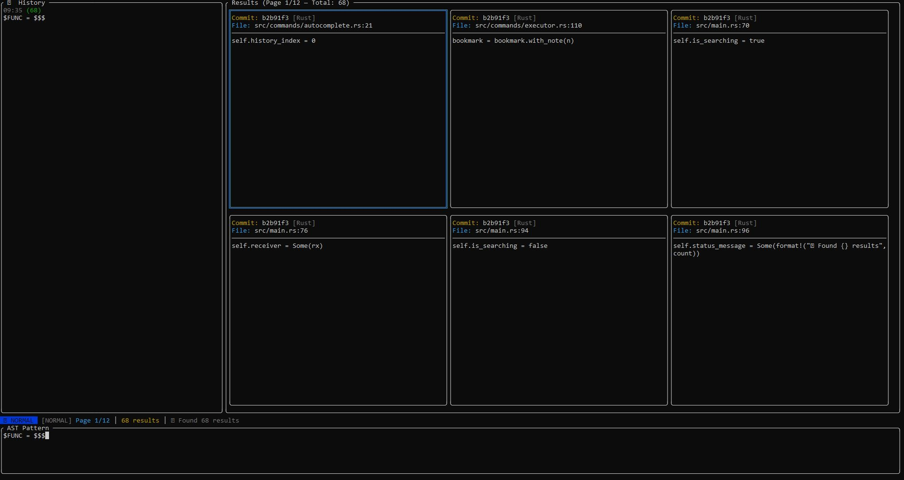
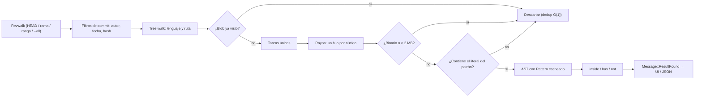
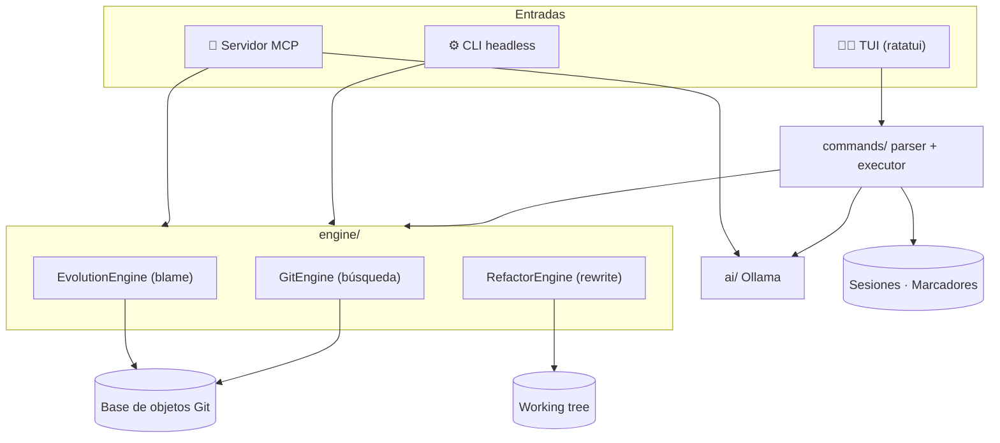

# 🦀 Git AST Search v0.3.0

> **Minería estructural de código a lo largo de toda la historia de Git.**
> Una TUI para humanos, un servidor MCP para agentes de IA y una interfaz compartida para cuando ambos trabajan juntos.


🇬🇧 [English version](./README_ENG.md)

**Git AST Search** busca **estructuras de código** (no texto) en **todos los commits** de un repositorio, leyendo los blobs directamente de la base de objetos de Git con `libgit2` — sin `checkout`, sin tocar tu working tree. Usa **Árboles de Sintaxis Abstracta (AST)** con Tree-Sitter / `ast-grep`, así que ignora comentarios, espacios, saltos de línea y formateo.



---

## 🧭 ¿Quién eres? Empieza aquí

| Si eres… | Lo que necesitas | Ve directo a |
|---|---|---|
| 👩‍💻 **Humano** (dev, auditor, reviewer) | Una TUI rápida con controles tipo Vim para explorar la historia del código | [Inicio rápido](#-inicio-rápido-60-segundos) · [Guía para Humanos](#-guía-para-humanos-la-tui) |
| 🤖 **Agente de IA** (Claude, Cursor, Antigravity, Windsurf…) | Herramientas MCP deterministas con salida JSON estructurada | [Guía para Agentes de IA](#-guía-para-agentes-de-ia-mcp--cli) · [Referencia rápida para agentes](#-referencia-rápida-para-agentes-copiable-en-un-system-prompt) |
| 🤝 **Humano + IA** trabajando juntos | Un modelo mental compartido: la IA busca, el humano ve y decide | [Flujos Humano ↔ IA](#-flujos-humano--ia-colaboración-simbiótica) |
| ⚙️ **DevOps / Seguridad** | Escaneos headless e integración con GitHub Code Scanning | [CI/CD y SARIF](#-cicd-y-github-code-scanning-sarif) |

---

## ✨ Novedades en v0.3.0

**Rendimiento y escalabilidad**
* ⚡ **Patrón compilado una sola vez** por lenguaje y por hilo (caché `Pattern` por `SupportLang`), en lugar de re-parsearlo en cada blob.
* 🔎 **Prefiltro literal**: se extrae el literal fijo más largo del patrón (p. ej. `unwrap` en `$A.unwrap()`) y se descartan en O(N) los blobs que no lo contienen, antes de invocar Tree-Sitter.
* ⏹ **Cancelación**: `Esc` (o lanzar una búsqueda nueva) detiene el escaneo en curso al instante.
* 📊 **Progreso en vivo** en la barra de estado: `⟳ Scanning blobs: 1200/3400 (35%) — 18 matches [Esc to cancel]`.
* 🧱 **Límites de memoria**: se saltan blobs binarios y de más de 2 MB; `--max-results` / `limit:N`; el historial guarda como máximo 500 resultados por consulta.
* 🌿 **Alcance Git**: `--branch`, `--range A..B`, `--all`, `--max-commits`.

**UX y funcionalidades**
* 📄 **Vista previa del blob histórico** (`d` / `Space`): el archivo completo *tal como era en ese commit*, numerado y centrado en la línea del match.
* ↗ **Abrir en el editor** (`o`): `$EDITOR +línea archivo` o `code -g archivo:línea`.
* 💾 **Historial persistente**: al arrancar, la TUI restaura las consultas de tu última sesión.
* 🧩 **Reglas compuestas** estilo ast-grep: `pattern`, `inside`, `has`, `not`.
* 🛡 **Exportación SARIF v2.1.0** (más CSV con escapado RFC-4180 y JSON).
* 🏺 **Modo diff en `/evolution`**: cada evento `[MUTATED]` muestra el antes (`-`, rojo) y el después (`+`, verde).

---

## 🌟 Propuesta de Valor

### 🗺️ Matriz de capacidades de un vistazo

| Pilar | ¿Qué hace? | 👩‍💻 Humano (TUI) | 🤖 Agente (MCP / CLI) | Valor clave |
|---|---|---|---|---|
| **⏳ Minería histórica** | Escanea todos los commits sin `git checkout` | `Enter` / `/search` | `git_ast_search` · `query` | Auditoría profunda sin tocar el disco ni el working tree |
| **🌳 Precisión AST** | Coincidencia sintáctica con `$VAR`, `$$$` | Barra de patrón | parámetro `pattern` | Cero falsos positivos por formato, comentarios o saltos de línea |
| **🧩 Reglas compuestas** | `inside` / `has` / `not` sobre el AST | `inside:… has:… not:…` | Regla YAML en `pattern` | Consultas contextuales ("unwrap *dentro de* un loop") |
| **⚡ Motor optimizado** | Dedup de blobs, prefiltro literal, caché de patrones, Rayon | Automático | Automático | Repos enormes en segundos, no en minutos |
| **🌿 Alcance Git** | Rama, rango, todas las refs, límite de commits | `branch:` `range:` `all:` `max_commits:` | `--branch` `--range` `--all` `--max-commits` | Busca exactamente en la porción de historia que importa |
| **📄 Blob histórico** | Muestra el archivo completo en el commit del hallazgo | `d` / `Space` | `commit_id` + `file_path` en JSON | Contexto real del pasado, sin hacer checkout |
| **↗ Búsqueda → acción** | Abre el hallazgo en tu editor | `o` | `file_path` + `line_number` | Cierra el ciclo: encontrar → arreglar |
| **🏺 AST Blame semántico** | Cuándo se introdujo, mutó o eliminó una estructura | `/evolution` (con diff `-`/`+`) | `git_ast_evolution` · `evolution` | Causa raíz de bugs ignorando el ruido de `fmt` |
| **🛠️ Refactor seguro** | Reescritura estructural, `dry-run` por defecto | `/refactor P -> R` | `git_ast_refactor` · `refactor` | Cambios masivos con preview obligatoria |
| **🦙 IA local (Ollama)** | Lenguaje natural → patrón AST; informes de auditoría | `/ai`, `/report` | `ai_query_ast`, `generate_git_ast_report` | Sin memorizar sintaxis; tu código no sale de tu máquina |
| **🛡 Exportación** | JSON, CSV (RFC-4180), SARIF 2.1.0 | `/export json\|csv\|sarif` | `--format json\|text\|sarif` | Integración con GitHub Code Scanning, hojas de cálculo y pipelines |
| **💾 Memoria de trabajo** | Sesiones, historial persistente, marcadores | `/save`, `/load`, `/bookmark`, `Tab` | — | Retoma la investigación días después |
| **🤝 Flujo simbiótico** | TUI y MCP sobre el mismo motor y el mismo repo | TUI abierta | MCP en el IDE | Humano e IA ven lo mismo — sin cajas negras |

### ¿Por qué no basta un servidor MCP conectado a `ast-grep`?

`ast-grep` es excelente para buscar en **el estado actual** de los archivos. Git AST Search resuelve otro problema:

1. **La dimensión temporal.** Busca en *toda la historia* leyendo blobs de Git en memoria, deduplicando los que no cambian entre commits. Responde a "¿cuándo apareció este patrón?", "¿quién lo introdujo?", "¿existía en la rama `release/1.x`?".
2. **Arqueología semántica.** `/evolution` reconstruye la línea de tiempo `INTRODUCED → MUTATED → REMOVED` de una estructura, con diff antes/después.
3. **Una interfaz compartida.** El agente consulta por MCP y el humano inspecciona, valida y actúa desde la TUI: el mismo motor, los mismos resultados, el mismo repositorio.
4. **Seguridad por diseño.** La historia es de solo lectura; la reescritura es `dry-run` salvo que se pida `--apply` / `dry_run: false` de forma explícita.

---

## 🚀 Inicio Rápido (60 segundos)

```bash
git clone https://github.com/plantacerium/Git-AST-Search
cd Git-AST-Search
cargo build --release

# 1. TUI interactiva sobre el repo actual
./target/release/git-ast-search .

# 2. Búsqueda headless en JSON
./target/release/git-ast-search query '$A.unwrap()' --lang rust --format json

# 3. Servidor MCP para tu agente de IA
./target/release/git-ast-search mcp /ruta/a/tu/repo
```

En la TUI escribe `$A.unwrap()`, pulsa `Enter`, navega con `j/k`, pulsa `d` para ver el archivo en ese commit y `o` para abrirlo en tu editor.

> [!TIP]
> En **PowerShell** y **bash** usa **comillas simples** para los patrones: con comillas dobles, `$A` o `$$` se expanden como variables de la shell (`$$` es el PID del proceso).

---

## 📦 Instalación

**Requisitos:** Rust estable (edición 2021), `cmake` y un compilador de C (para `libgit2` / Tree-Sitter).

| Sistema | Dependencias |
|---|---|
| **Fedora / RHEL** | `sudo dnf install cmake openssl-devel libgit2-devel zlib-devel` |
| **Ubuntu / Debian** | `sudo apt install cmake libssl-dev libgit2-dev zlib1g-dev` |
| **macOS** | `xcode-select --install && brew install cmake` |
| **Windows** | Visual Studio Build Tools (C++) + `cmake` (p. ej. `winget install Kitware.CMake`) |

```bash
cargo build --release          # binario en target/release/git-ast-search
cargo install --path .         # opcional: instalarlo en tu PATH
cargo test                     # ejecutar la batería de tests
```

---

## 🎯 Apuntar a cualquier repositorio

El binario es portable: **no** necesita estar dentro del repositorio que audita.

| Modo | Cómo elegir el repositorio | Ejemplo |
|---|---|---|
| **TUI** | Primer argumento posicional (por defecto `.`) | `git-ast-search D:\proyectos\backend` |
| **Headless** | `--repo <RUTA>` | `git-ast-search query '$A.unwrap()' --repo ~/dev/app` |
| **MCP** | Ruta al arrancar + `repo_path` opcional en cada llamada | `git-ast-search mcp ~/dev/app` |

> [!NOTE]
> Búsqueda, `/evolution` y la vista de blob trabajan sobre la **base de objetos de Git** (historia, solo lectura). `/refactor` y la tecla `o` trabajan sobre el **working tree** (los archivos actuales en disco).

---

## 🧬 El Lenguaje de Patrones

Los patrones se escriben **como código real** del lenguaje objetivo, con metavariables:

| Sintaxis | Significado | Ejemplo |
|---|---|---|
| `$A`, `$VAR`, `$FUNC` | Exactamente **un** nodo AST (nombre en MAYÚSCULAS) | `$OBJ.unwrap()` |
| `$$$` | **Cero o más** nodos (argumentos, sentencias…) | `println!($$$)` |
| `$$$ARGS` | Lista variádica con nombre (reutilizable en un rewrite) | `foo($$$ARGS)` |
| `$_` | Comodín que no se captura | `let _ = $_;` |

### Reglas compuestas (`inside`, `has`, `not`)

| Restricción | Se cumple cuando… |
|---|---|
| `inside: P` | algún **ancestro** del match coincide con `P` |
| `has: P` | algún **descendiente** del match coincide con `P` |
| `not: P` | el propio match **no** coincide con `P` |

**Formato YAML** (CLI y MCP — el patrón puede ser una cadena multilínea):

```yaml
rule:
  pattern: $A.unwrap()
  inside:
    pattern: for $X in $Y { $$$ }
  not:
    pattern: self.$B.unwrap()
```

**Formato en línea** (TUI): `/search $A.unwrap() lang:rust not:self.$B.unwrap()`

> [!IMPORTANT]
> En la TUI los argumentos se separan por espacios, así que los valores de `inside:` / `has:` / `not:` deben ir **sin espacios**. Para restricciones con espacios usa el formato YAML vía CLI o MCP.

---

## 👩‍💻 Guía para Humanos (La TUI)

### Anatomía de la pantalla

```
┌─ 📜 History ──────┐┌─ Results (página 1/4) ───────────────────────────────┐
│ ▸ $A.unwrap()  42 ││ [7f8dde0] src/ui/app.rs:102  (Rust)  pulsarforge     │
│   unsafe{$$$}   3 ││   let parsed = CommandParser::parse(&input)          │
│   console.log…  0 ││ [4f19c20] src/main.rs:164   (Rust)  pulsarforge      │
└───────────────────┘└───────────────────────────────────────────────────────┘
┌─ AST Pattern (Enter to search) ──────────────────────────────────────────────┐
└──────────────────────────────────────────────────────────────────────────────┘
 NORMAL │ ⟳ Scanning blobs: 1200/3400 (35%) — 18 matches [Esc to cancel]
```

### Controles

**Modo Insert** (escribir el patrón o regla)

| Tecla | Acción |
|---|---|
| *cualquiera* | Escribir patrón AST o símbolos (`{ } [ ] ~ @ # \| \` con soporte completo `AltGr`) |
| `Enter` | Iniciar búsqueda (en modo patrón estándar) o nueva línea (en editor de reglas) |
| `Shift+Enter` / `Alt+Enter` | Insertar salto de línea para escribir reglas compuestas |
| `Ctrl+E` | 📜 Alternar **Modo Editor de Reglas YAML** (la caja se expande para reglas con `inside/not`) |
| `Ctrl+Enter` | Ejecutar búsqueda multilínea en el Editor de Reglas |
| `Ctrl+V` | 📋 Pegar texto o regla desde el portapapeles del sistema operativo |
| `Esc` | Volver al modo Normal |

**Modo Normal** (navegar)

| Tecla | Acción |
|---|---|
| `j` / `↓` · `k` / `↑` | Siguiente / anterior resultado (o consulta, en el Historial) |
| `h` / `←` · `l` / `→` | Página anterior / siguiente · saltar entre Historial y Resultados |
| `gg` · `G` | Primer / último resultado |
| `d` / `Space` | 📄 **Vista previa del blob histórico** con **resaltado de sintaxis (`syntect`)** y línea del match |
| `o` | ↗ **Abrir en el editor** en la línea exacta |
| `y` / `Ctrl+C` | 📋 **Copiar match al portapapeles** (`commit_short file:line\ncode`) |
| `Y` | 📋 **Copiar contexto completo al portapapeles** (snippet circundante) |
| `Ctrl+V` | 📋 Pegar texto del portapapeles en el editor de patrones |
| `Ctrl+E` | 📜 Alternar **Modo Editor de Reglas YAML** (expande el área de input) |
| `Tab` | Alternar foco Resultados ⇆ Historial |
| `Enter` / `r` | (Historial) Re-ejecutar la consulta seleccionada · (Resultados) Iniciar búsqueda |
| `e` / `i` | (Historial) Cargar la consulta en el editor |
| `i` / `a` | Entrar en modo Insert |
| `v` | Modo Visual (`b` para marcar el resultado) |
| `/` o `:` | Modo Comando (`Tab` autocompleta, `↑/↓` historial de comandos, `Ctrl+V` pega) |
| `Ctrl+B` | Mostrar / ocultar el panel lateral |
| `?` | Ayuda |
| `Esc` | **Cancelar la búsqueda en curso** · cerrar modal · volver a Resultados · salir |

**Modales** (blob, `/evolution`, `/refactor`, `/help`…): `j/k` para desplazarse, `Esc` / `q` para cerrar.

### Comandos

| Categoría | Comando | Descripción |
|---|---|---|
| 🔍 Búsqueda | `/search <patrón> [filtros]` (`/s`) | Buscar en la historia. Texto sin `/` = búsqueda directa |
| | `/filter <filtros>` (`/f`) | Filtrar los resultados actuales sin volver a escanear |
| | `/patterns [lenguaje]` | Catálogo de patrones integrados |
| 🧭 Navegación | `/next` `/prev` `/first` `/last` `/page <n>` | Moverse por los resultados |
| | `/goto <commit> [archivo] [línea]` (`/g`) | Saltar a un resultado concreto |
| | `/history` (`/hist`) · `/replay [N]` (`/rerun`) | Enfocar el Historial · re-ejecutar la consulta N |
| 💾 Memoria | `/bookmark [etiqueta] [--note …]` · `/bookmarks` · `/unbookmark <id>` | Marcadores persistentes |
| | `/save [nombre]` · `/load <nombre>` · `/sessions` | Sesiones de investigación |
| 📤 Exportar | `/export json\|csv\|sarif [ruta]` (`/e`) | Por defecto `results.<formato>` |
| 🏺 Historia | `/evolution <patrón> [opciones]` (`/blame`) | Línea de tiempo con diff `-`/`+` (`--branch`, `--range`, `--max-commits`) |
| 🛠 Refactor | `/refactor <P> -> <R> [--apply]` (`/rewrite`) | Preview de reescritura; `--apply` escribe en disco |
| 🦙 IA | `/ai <pregunta>` · `/report [tema]` | Lenguaje natural → patrón · informe `audit_report.md` |
| ⚙️ Sistema | `/help [cmd]` · `/clear` · `/toggle` · `/quit` | |

### Filtros (`clave:valor` o `--clave valor`)

| Filtro | Alias | Ejemplo | Efecto |
|---|---|---|---|
| `lang` | `language`, `l` | `lang:rs` | Lenguaje (acepta alias: `rs`, `js`, `ts`, `py`, `cpp`…) |
| `author` | `a`, `user` | `author:alice` | Autor del commit (subcadena) |
| `file` | `path`, `f` | `file:src/engine` | Ruta del archivo (subcadena) |
| `commit` | `c` | `commit:7f8dde0` | Prefijo del hash |
| `after` / `before` | `since` / `until` | `after:2025-01-01` | Rango de fechas (`AAAA-MM-DD`) |
| `branch` | `b` | `branch:develop` | Recorrer una rama en lugar de `HEAD` |
| `range` | — | `range:v1.0..HEAD` | Rango de commits |
| `all` | — | `all:true` | Todas las ramas locales y remotas |
| `max_commits` | `commits` | `max_commits:200` | Máximo de commits recorridos |
| `limit` | `max_results` | `limit:100` | Máximo de resultados (por defecto 5000) |
| `inside` / `has` / `not` | — | `not:self.$B.unwrap()` | Restricciones relacionales |

### Persistencia

Sesiones, historial y marcadores se guardan en el directorio de datos de la aplicación (`directories::ProjectDirs` → `…/GitASTSearch/sessions`). Al arrancar, la TUI carga automáticamente la sesión más reciente.

---

## 🤖 Guía para Agentes de IA (MCP + CLI)

### Conectar el servidor MCP

El servidor habla **JSON-RPC 2.0 sobre stdio** (protocolo MCP `2024-11-05`).

```json
{
  "mcpServers": {
    "git-ast-search": {
      "command": "/ruta/absoluta/a/git-ast-search",
      "args": ["mcp", "/ruta/al/repo/por/defecto"],
      "env": { "OLLAMA_HOST": "http://localhost:11434" }
    }
  }
}
```

Funciona con Claude Desktop / Claude Code, Cursor, Windsurf, Antigravity y cualquier cliente MCP compatible con stdio.

### Herramientas MCP

| Herramienta | Parámetros | Devuelve | Efectos secundarios |
|---|---|---|---|
| `git_ast_search` | `pattern`* · `repo_path` · `lang` · `branch` · `range` · `all` · `max_results` · `max_commits` · `author` · `path` · `after` · `before` | `SearchResult[]` | Ninguno (solo lectura) |
| `git_ast_evolution` | `pattern`* · `repo_path` · `lang` · `branch` · `range` · `max_commits` | `EvolutionTimeline` | Ninguno (solo lectura) |
| `git_ast_refactor` | `pattern`* · `rewrite`* · `dry_run` (def. `true`) · `repo_path` · `lang` | `RefactorResult` | **Escribe en disco solo si `dry_run: false`** |
| `list_ast_patterns` | `lang` | Catálogo `{language, patterns[]}` | Ninguno |
| `ai_query_ast` | `prompt`* | `{pattern, lang, explanation}` | Llama a Ollama local |
| `generate_git_ast_report` | `pattern`* · `repo_path` | Informe Markdown | Llama a Ollama local |

<sub>* obligatorio</sub>

### Esquemas de salida

```jsonc
// SearchResult (git_ast_search, query --format json)
{
  "id": "…",                    // id único del resultado
  "commit_id": "7f8dde06bb5c…", // hash completo
  "commit_short": "7f8dde0",
  "file_path": "src/ui/app.rs",
  "line_number": 102,           // 1-based
  "lang": "Rust",
  "matched_text": "CommandParser::parse(&input)",
  "content": "…±2 líneas de contexto…",
  "author": "pulsarforge",
  "timestamp": "2026-04-08T08:56:39Z"
}

// EvolutionEntry (dentro de EvolutionTimeline.history)
{
  "action": "MUTATED",          // INTRODUCED | MUTATED | REMOVED
  "commit_short": "4f19c20", "author": "…", "date": "…", "message": "…",
  "file_path": "src/main.rs", "line_number": 164,
  "previous_snippet": "…",      // solo en MUTATED
  "snippet": "…"
}

// RefactorResult
{ "pattern": "…", "rewrite": "…", "dry_run": true,
  "total_matches": 12, "files_affected": 4,
  "diffs": [{ "file_path": "…", "line_number": 10, "original": "…", "replacement": "…" }] }
```

### Contrato del modo headless (CLI)

| Comando | Opciones | Salida |
|---|---|---|
| `query <PATRÓN>` | `--repo` `--lang` `--branch` `--range` `--all` `--max-commits` `--max-results` `--format json\|text\|sarif` | `SearchResult[]` / texto / SARIF |
| `evolution <PATRÓN>` (`blame`) | `--repo` `--lang` `--format json\|text` | `EvolutionTimeline` |
| `refactor <P> <R>` (`rewrite`) | `--repo` `--lang` `--apply` | `RefactorResult` |
| `ai <PROMPT>` | `--repo` | `{prompt, pattern, lang, explanation, results_count, results}` |
| `mcp [REPO]` | — | Servidor JSON-RPC en stdio |

* **stdout** contiene solo el resultado (JSON limpio, apto para `jq`); los mensajes de progreso van a **stderr**.
* **Código de salida** `0` = éxito, `1` = error (patrón vacío, repo inválido, rama/rango inexistente…).

### 📋 Referencia rápida para agentes (copiable en un system prompt)

```text
TOOL: git-ast-search — búsqueda estructural (AST) en TODA la historia de Git.
- Usa git_ast_search para preguntas de "dónde / cuándo / quién" sobre estructuras de código.
- Los patrones son código real con metavariables: $A (un nodo), $$$ (cero o más nodos).
- Acota siempre: pasa `lang`; en CLI usa --max-results / --max-commits en repos grandes.
- Usa git_ast_evolution para la causa raíz: INTRODUCED -> MUTATED (con previous_snippet) -> REMOVED.
- git_ast_refactor es dry-run por defecto. Enseña los diffs al humano y pide confirmación
  explícita ANTES de llamar con dry_run:false.
- Cita los hallazgos como `commit_short file_path:line_number` para que el humano pueda
  abrirlos en la TUI (/goto <commit> <archivo> <línea>, luego `d` para ver el blob).
- Sin resultados: prueba un patrón más general ($$$ en lugar de argumentos concretos) o revisa `lang`.
```

### Buenas prácticas para agentes

1. **Empieza amplio y luego acota**: `fn $F($$$)` → `fn $F($$$) -> Result<$T, $E>`.
2. **Comprueba el catálogo** con `list_ast_patterns` antes de inventar un patrón.
3. **Nunca escribas en disco sin consentimiento**: `dry_run: true` → mostrar diffs → confirmación → `dry_run: false`.
4. **Los resultados son históricos**: un match en un commit antiguo puede no existir en `HEAD`. Compara `commit_id` con el estado actual antes de proponer un arreglo.
5. **Devuelve referencias navegables** (`commit_short file:line`) en lugar de volcar todo el JSON.

---

## 🤝 Flujos Humano ↔ IA (Colaboración Simbiótica)

El humano mantiene la **TUI abierta** en una terminal; el agente usa el **servidor MCP** desde el IDE. Ambos operan sobre el mismo motor y el mismo repositorio.

```mermaid
sequenceDiagram
    participant H as 👩‍💻 Humano (TUI)
    participant A as 🤖 Agente (IDE)
    participant M as git-ast-search mcp
    participant G as Historia Git
    H->>A: "¿Dónde manejamos mal los errores en el engine?"
    A->>M: git_ast_search { pattern: "$A.unwrap()", lang: "rust" }
    M->>G: revwalk + dedup de blobs + AST
    G-->>M: matches
    M-->>A: SearchResult[]
    A-->>H: "42 hallazgos; los 3 críticos: 7f8dde0 src/engine/mod.rs:540…"
    H->>H: /search $A.unwrap() lang:rust → j/k, d (blob), o (editor)
    H->>A: "Propón un refactor para src/engine"
    A->>M: git_ast_refactor { dry_run: true }
    M-->>A: diffs
    A-->>H: preview de los diffs
    H->>A: "Aprobado"
    A->>M: git_ast_refactor { dry_run: false }
```

### Playbooks

| Escenario | 🤖 La IA… | 👩‍💻 El humano… |
|---|---|---|
| **Triage de seguridad** | Busca `unsafe { $$$ }`, `strcpy($$$)`, `eval($$$)` y prioriza | Revisa cada hallazgo con `d`, marca con `/bookmark`, exporta `/export sarif` |
| **Arqueología de un bug** | Ejecuta `git_ast_evolution` y señala el commit `MUTATED` sospechoso | Abre `/evolution`, lee el diff `-`/`+`, confirma la causa raíz |
| **Migración de API** | Encuentra los usos antiguos y genera un `git_ast_refactor` en dry-run | Valida la preview y aprueba el `--apply` |
| **Onboarding** | Explica los patrones del catálogo y por qué importan | Explora los resultados en la TUI y guarda la sesión con `/save onboarding` |
| **Code review** | Busca anti-patrones en `range:main..feature` | Navega los resultados y deja notas con `/bookmark --note` |
| **IA 100 % local** | — | Usa `/ai encuentra bloques catch vacíos` (Ollama): ningún código sale de la máquina |

---

## 🛡 CI/CD y GitHub Code Scanning (SARIF)

```yaml
# .github/workflows/ast-audit.yml
name: AST Audit
on: [push, pull_request]
jobs:
  audit:
    runs-on: ubuntu-latest
    permissions: { security-events: write, contents: read }
    steps:
      - uses: actions/checkout@v4
        with: { fetch-depth: 0 }          # historia completa
      - run: cargo install --git https://github.com/plantacerium/Git-AST-Search
      - run: git-ast-search query '$A.unwrap()' --lang rust --max-commits 50 --format sarif > ast.sarif
      - uses: github/codeql-action/upload-sarif@v3
        with: { sarif_file: ast.sarif }
```

```bash
# Contar unwraps en los últimos 100 commits
git-ast-search query '$A.unwrap()' --lang rs --max-commits 100 | jq length

# Comparar una rama de feature con main
git-ast-search query 'console.log($$$)' --range main..feature/login --format text
```

---

## ⚙️ Configuración

| Variable | Por defecto | Uso |
|---|---|---|
| `OLLAMA_HOST` | `http://localhost:11434` | Endpoint de Ollama para `/ai`, `/report` y las herramientas MCP de IA |
| `OLLAMA_MODEL` | `qwen2.5-coder:latest` | Modelo que traduce lenguaje natural a patrones |
| `EDITOR` / `VISUAL` | `code` | Editor que abre la tecla `o` (`code`/`cursor` usan `-g archivo:línea`; el resto, `+línea archivo`) |

---

## ⚡ Cómo es tan rápido



1. **Deduplicación de blobs**: un archivo que no cambia en 1.000 commits se analiza **una sola vez**.
2. **Prefiltro literal**: la mayoría de blobs se descartan con una búsqueda de subcadena, sin parsear.
3. **Caché de `Pattern`**: el patrón se compila una vez por lenguaje y por hilo.
4. **Paralelismo con Rayon** sobre las tareas únicas, con un `Repository` por hilo.
5. **Streaming**: los resultados llegan a la UI por un canal `mpsc` a medida que se encuentran.

---

## 🔍 Ejemplos Multilenguaje

> **📖 Pro tip:** el [Catálogo de Exploración de Código](./code_exploration.md) contiene **260 patrones AST listos para usar**.

| Lenguaje | Objetivo | Patrón |
|---|---|---|
| 🤖 Android (Kotlin) | Desempaquetado forzado nulo | `$X!!` |
| | Fuga de corrutinas no acotadas | `GlobalScope.launch { $$$ }` |
| | Log de depuración residual | `Log.$M($TAG, $MSG)` |
| 🎯 Flutter (Dart) | Re-renderizado de estado | `setState(() { $$$ })` |
| | Prints de depuración | `debugPrint($$$)` |
| 🍏 iOS (Swift) | Force-try inseguro | `try! $F($$$)` |
| | Desempaquetado forzado de opcional | `$X!` |
| 🔷 C# (.NET) | Bloque inseguro | `unsafe { $$$ }` |
| | Bloqueo de hilo sincrónico | `Thread.Sleep($$$)` |
| ⚡ Solidity (Web3) | Riesgo de phishing por tx.origin | `tx.origin` |
| | Autodestrucción de contrato | `selfdestruct($$$)` |
| 🐚 Bash / Shell | Ejecución de eval insegura | `eval $$$` |
| 🦀 Rust | Bloques `unsafe` | `unsafe { $$$ }` |
| | Desempaquetados arriesgados | `$OBJ.unwrap()` · `$OBJ.expect($MSG)` |
| | Errores silenciados | `let _ = $FUNC($$$);` |
| 🌐 JS / TS | `console.log` olvidados | `console.log($$$)` |
| | Promesas encadenadas | `$A.then($$$).then($$$)` |
| | `catch` vacío | `catch ($E) { }` |
| 🐍 Python | Argumentos por defecto mutables | `def $F($ARG = []): $$$` |
| | `except` silencioso | `try:\n    $$$\nexcept $ERR:\n    pass` |
| 🐹 Go | Errores ignorados | `$VAL, _ := $FUNC($$$)` |
| | Goroutines anónimas | `go func() { $$$ }()` |
| ☕ Java | Print debugging | `System.out.println($$$);` |
| | `catch` genérico | `catch (Exception $E) { $$$ }` |
| ⚙️ C / C++ | Cadenas inseguras | `strcpy($DEST, $SRC)` · `sprintf($$$)` |
| | Memoria manual | `free($PTR);` · `delete $PTR;` |

### 🌐 26 Lenguajes Soportados Nativamente con Tree-Sitter

1. **Android & Móvil:** Kotlin (`.kt`, `.kts`, alias: `android`, `kt`), Java (`.java`), Dart / Flutter (`.dart`, alias: `flutter`), Swift (`.swift`, alias: `ios`).
2. **Sistemas & Backend:** Rust (`.rs`), Go (`.go`), C (`.c`, `.h`), C++ (`.cpp`, `.cc`, `.cxx`), C# (`.cs`, alias: `c#`, `dotnet`), Scala (`.scala`, `.sc`).
3. **Web & Scripting:** TypeScript (`.ts`, `.tsx`), JavaScript (`.js`, `.jsx`), Python (`.py`), Ruby (`.rb`), PHP (`.php`), Lua (`.lua`), Bash/Shell (`.sh`, `.bash`, `.zsh`).
4. **Smart Contracts, Cloud & IaC:** Solidity (`.sol`, alias: `web3`, `solidity`), HCL / Terraform (`.tf`, `.hcl`, alias: `terraform`), Nix (`.nix`).
5. **Formatos de Datos & Estilos:** HTML (`.html`, `.htm`), CSS/SCSS (`.css`, `.scss`), JSON (`.json`), YAML (`.yaml`, `.yml`).
6. **Programación Funcional:** Elixir (`.ex`, `.exs`), Haskell (`.hs`).

---

## 🏗 Arquitectura

```
Git-AST-Search/
├── src/
│   ├── main.rs                 # Punto de entrada: TUI, query, ai, refactor, evolution, mcp
│   ├── engine/                 # Núcleo: git2 + ast-grep + Rayon
│   │   ├── mod.rs              # GitEngine: revwalk, dedup, prefiltro, reglas compuestas, blobs
│   │   ├── evolution.rs        # EvolutionEngine: AST Blame semántico con diff
│   │   └── refactor.rs         # RefactorEngine: reescritura con metavariables, dry-run
│   ├── mcp/server.rs           # Servidor MCP JSON-RPC 2.0 (stdio)
│   ├── ai/                     # Cliente Ollama y prompts del sistema
│   ├── commands/               # Comandos slash: parser, executor, registry, autocomplete, export
│   ├── navigation/             # Estado de navegación y modos Vim (Normal/Insert/Visual/Command)
│   ├── languages/              # Detección por extensión, alias y catálogo de patrones (26 lenguajes)
│   ├── modules/                # Modelos: SearchResult, ChatEntry, Session, Bookmark, Filter, Config
│   └── ui/                     # ratatui: app, layout, render y componentes
├── docs/                       # Documentación técnica detallada
├── code_exploration.md         # Catálogo de 260 patrones
├── README.md · README_ENG.md
└── Cargo.toml
```



Más detalle: [docs/architecture.md](./docs/architecture.md) · [docs/ai_agents.md](./docs/ai_agents.md) · [docs/code_analysis.md](./docs/code_analysis.md)

---

## 🚧 Limitaciones Conocidas y Roadmap

| Área | Estado actual | Dirección |
|---|---|---|
| Lenguajes | **26 lenguajes** con análisis sintáctico Tree-Sitter nativo (incluyendo Android Kotlin, Dart, Swift, Solidity, C#) | Carga dinámica de gramáticas externas Tree-Sitter mediante plugins |

---

## ❓ FAQ

**¿Modifica mi repositorio?** No. La búsqueda, `/evolution` y la vista de blob solo leen. Únicamente `/refactor --apply` (o `dry_run: false`) escribe, y solo en el working tree.

**¿Mi código se envía a la nube?** No. Las funciones de IA usan **Ollama local**. Si no usas `/ai`, `/report` o las herramientas de IA, no hay ninguna llamada de red.

**¿Por qué mi patrón no encuentra nada?** El patrón debe ser código sintácticamente válido en el lenguaje objetivo. Prueba con `$$$` para generalizar, revisa el filtro `lang` y, en la shell, usa comillas simples.

**¿Cómo lo uso en un repo enorme?** Acota con `--max-commits`, `--range`, `--lang` y `--max-results`. En la TUI, `Esc` cancela en cualquier momento.

---

## 🤲 Contribuir

Lee [docs/contributing.md](./docs/contributing.md). Antes de abrir un PR: `cargo fmt`, `cargo clippy` y `cargo test`.

## 📄 Licencia

MIT — úsalo, modifícalo y distribúyelo para empujar los límites de la minería de código estructural.
