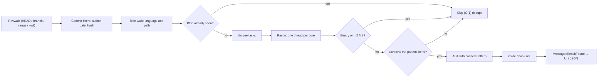
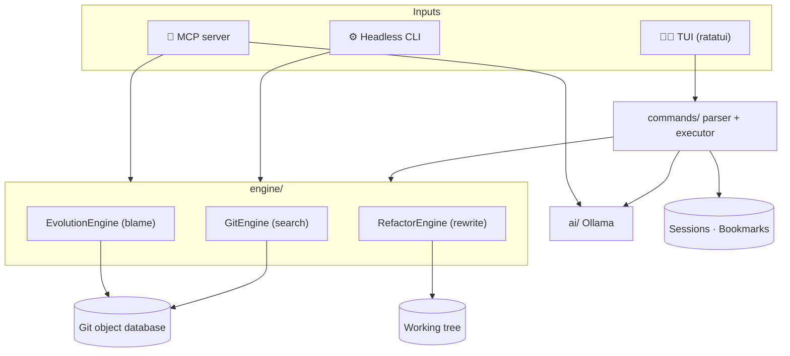

# 🦀 Git AST Search v0.3.0

> **Structural code mining across your entire Git history.**
> A TUI for humans, an MCP server for AI agents, and a shared interface for when they work together.


🇪🇸 [Versión en español](./README.md)

**Git AST Search** finds **code structures** (not text) across **every commit** of a repository, reading blobs straight from Git's object database through `libgit2`: no `checkout`, and your working tree is never touched. It uses **Abstract Syntax Trees (AST)** via Tree-Sitter / `ast-grep`, so comments, whitespace, line breaks and formatting don't affect matches.


---

## 🧭 Who are you? Start here

| If you are… | What you need | Go to |
|---|---|---|
| 👩‍💻 **Human** (dev, auditor, reviewer) | A fast, Vim-style TUI to explore code history | [Quick start](#-quick-start-60-seconds) · [Human guide](#-human-guide-the-tui) |
| 🤖 **AI agent** (Claude, Cursor, Antigravity, Windsurf…) | Deterministic MCP tools with structured JSON output | [AI agent guide](#-ai-agent-guide-mcp--cli) · [Agent quick reference](#-agent-quick-reference-paste-into-a-system-prompt) |
| 🤝 **Human + AI** working together | A shared mental model: the AI searches, the human sees and decides | [Human ↔ AI workflows](#-human--ai-workflows-symbiotic-collaboration) |
| ⚙️ **DevOps / Security** | Headless scans and GitHub Code Scanning integration | [CI/CD & SARIF](#-cicd--github-code-scanning-sarif) |

---

## ✨ What's new in v0.3.0

**Performance & scalability**
* ⚡ **Pattern compiled once** per language and per thread (`Pattern` cache keyed by `SupportLang`) instead of being re-parsed for every blob.
* 🔎 **Literal pre-filter**: the longest fixed literal in the pattern (e.g. `unwrap` in `$A.unwrap()`) is extracted, and blobs that don't contain it are skipped in O(N), before Tree-Sitter runs.
* ⏹ **Cancellation**: `Esc` (or starting a new search) stops the running scan immediately.
* 📊 **Live progress** in the status bar: `⟳ Scanning blobs: 1200/3400 (35%) — 18 matches [Esc to cancel]`.
* 🧱 **Memory bounds**: binary blobs and blobs over 2 MB are skipped; `--max-results` / `limit:N`; history keeps at most 500 cached results per query.
* 🌿 **Git scope**: `--branch`, `--range A..B`, `--all`, `--max-commits`.

**UX & features**
* 📄 **Historical blob preview** (`d` / `Space`): the full file *as it was in that commit*, with line numbers, centred on the match.
* ↗ **Open in editor** (`o`): `$EDITOR +line file` or `code -g file:line`.
* 💾 **Persistent history**: on startup, the TUI restores the queries from your last session.
* 🧩 **ast-grep-style composite rules**: `pattern`, `inside`, `has`, `not`.
* 🛡 **SARIF v2.1.0 export** (plus RFC-4180 CSV and JSON).
* 🏺 **Diff mode in `/evolution`**: every `[MUTATED]` event shows the before (`-`, red) and the after (`+`, green).

---

## 🌟 Value Proposition

### 🗺️ Capability matrix at a glance

| Pillar | What it does | 👩‍💻 Human (TUI) | 🤖 Agent (MCP / CLI) | Key value |
|---|---|---|---|---|
| **⏳ Historical mining** | Scans every commit without `git checkout` | `Enter` / `/search` | `git_ast_search` · `query` | Deep audits without touching the disk or working tree |
| **🌳 AST precision** | Syntactic matching with `$VAR`, `$$$` | Pattern bar | `pattern` param | No false positives from formatting, comments or line breaks |
| **🧩 Composite rules** | `inside` / `has` / `not` over the AST | `inside:… has:… not:…` | YAML rule in `pattern` | Contextual queries ("unwrap *inside* a loop") |
| **⚡ Optimised engine** | Blob dedup, literal pre-filter, pattern cache, Rayon | Automatic | Automatic | Huge repos in seconds, not minutes |
| **🌿 Git scope** | Branch, range, all refs, commit limit | `branch:` `range:` `all:` `max_commits:` | `--branch` `--range` `--all` `--max-commits` | Search exactly the slice of history that matters |
| **📄 Historical blob** | Shows the full file at the match's commit | `d` / `Space` | `commit_id` + `file_path` in JSON | Real past context, no checkout |
| **↗ Search → action** | Opens the finding in your editor | `o` | `file_path` + `line_number` | Closes the loop: find → fix |
| **🏺 Semantic AST blame** | When a structure was introduced, mutated or removed | `/evolution` (with `-`/`+` diff) | `git_ast_evolution` · `evolution` | Root cause of bugs, ignoring `fmt` noise |
| **🛠️ Safe refactor** | Structural rewrite, `dry-run` by default | `/refactor P -> R` | `git_ast_refactor` · `refactor` | Mass changes with a mandatory preview |
| **🦙 Local AI (Ollama)** | Natural language → AST pattern; audit reports | `/ai`, `/report` | `ai_query_ast`, `generate_git_ast_report` | No syntax to memorise; your code never leaves your machine |
| **🛡 Export** | JSON, CSV (RFC-4180), SARIF 2.1.0 | `/export json\|csv\|sarif` | `--format json\|text\|sarif` | GitHub Code Scanning, spreadsheets and pipelines |
| **💾 Working memory** | Sessions, persistent history, bookmarks | `/save`, `/load`, `/bookmark`, `Tab` | — | Pick an investigation back up days later |
| **🤝 Symbiotic workflow** | TUI and MCP on the same engine and the same repo | TUI open | MCP in the IDE | Human and AI see the same thing, with no black boxes |

### Why isn't an MCP server wrapping `ast-grep` enough?

`ast-grep` is excellent at searching the **current state** of your files. Git AST Search solves a different problem:

1. **The time dimension.** It searches *the whole history* by reading Git blobs in memory and deduplicating the ones that don't change between commits. It answers "when did this pattern appear?", "who introduced it?", "did it exist on `release/1.x`?".
2. **Semantic archaeology.** `/evolution` rebuilds the `INTRODUCED → MUTATED → REMOVED` timeline of a structure, with a before/after diff.
3. **A shared interface.** The agent queries over MCP while the human inspects, validates and acts from the TUI, with the same engine, the same results and the same repository.
4. **Safe by design.** History is read-only; rewriting is `dry-run` unless `--apply` / `dry_run: false` is explicitly requested.

---

## 🚀 Quick Start (60 seconds)

```bash
git clone https://github.com/plantacerium/Git-AST-Search
cd Git-AST-Search
cargo build --release

# 1. Interactive TUI on the current repo
./target/release/git-ast-search .

# 2. Headless search with JSON output
./target/release/git-ast-search query '$A.unwrap()' --lang rust --format json

# 3. MCP server for your AI agent
./target/release/git-ast-search mcp /path/to/your/repo
```

In the TUI, type `$A.unwrap()`, press `Enter`, move with `j/k`, press `d` to see the file at that commit and `o` to open it in your editor.

> [!TIP]
> In **PowerShell** and **bash**, wrap patterns in **single quotes**. With double quotes, `$A` or `$$` get expanded as shell variables (`$$` is the process PID).

---

## 📦 Installation

**Requirements:** stable Rust (2021 edition), `cmake` and a C compiler (for `libgit2` / Tree-Sitter).

| System | Dependencies |
|---|---|
| **Fedora / RHEL** | `sudo dnf install cmake openssl-devel libgit2-devel zlib-devel` |
| **Ubuntu / Debian** | `sudo apt install cmake libssl-dev libgit2-dev zlib1g-dev` |
| **macOS** | `xcode-select --install && brew install cmake` |
| **Windows** | Visual Studio Build Tools (C++) + `cmake` (e.g. `winget install Kitware.CMake`) |

```bash
cargo build --release          # binary at target/release/git-ast-search
cargo install --path .         # optional: install it on your PATH
cargo test                     # run the test suite
```

---

## 🎯 Point it at any repository

The binary is portable: it does **not** need to live inside the repository it audits.

| Mode | How to choose the repository | Example |
|---|---|---|
| **TUI** | First positional argument (default `.`) | `git-ast-search D:\projects\backend` |
| **Headless** | `--repo <PATH>` | `git-ast-search query '$A.unwrap()' --repo ~/dev/app` |
| **MCP** | Path at startup + optional `repo_path` on each call | `git-ast-search mcp ~/dev/app` |

> [!NOTE]
> Search, `/evolution` and the blob preview work on the **Git object database** (history, read-only). `/refactor` and the `o` key work on the **working tree** (the current files on disk).

---

## 🧬 The Pattern Language

Patterns are written **as real code** in the target language, with metavariables:

| Syntax | Meaning | Example |
|---|---|---|
| `$A`, `$VAR`, `$FUNC` | Exactly **one** AST node (UPPERCASE name) | `$OBJ.unwrap()` |
| `$$$` | **Zero or more** nodes (arguments, statements…) | `println!($$$)` |
| `$$$ARGS` | Named variadic list (reusable in a rewrite) | `foo($$$ARGS)` |
| `$_` | Non-capturing wildcard | `let _ = $_;` |

### Composite rules (`inside`, `has`, `not`)

| Constraint | Satisfied when… |
|---|---|
| `inside: P` | some **ancestor** of the match matches `P` |
| `has: P` | some **descendant** of the match matches `P` |
| `not: P` | the match itself does **not** match `P` |

**YAML format** (CLI and MCP; the pattern may be a multi-line string):

```yaml
rule:
  pattern: $A.unwrap()
  inside:
    pattern: for $X in $Y { $$$ }
  not:
    pattern: self.$B.unwrap()
```

**Inline format** (TUI): `/search $A.unwrap() lang:rust not:self.$B.unwrap()`

> [!IMPORTANT]
> The TUI splits arguments on spaces, so `inside:` / `has:` / `not:` values must contain **no spaces**. For constraints with spaces, use the YAML format through the CLI or MCP.

---

## 👩‍💻 Human Guide (The TUI)

### Screen anatomy

```
┌─ 📜 History ──────┐┌─ Results (page 1/4) ─────────────────────────────────┐
│ ▸ $A.unwrap()  42 ││ [7f8dde0] src/ui/app.rs:102  (Rust)  pulsarforge     │
│   unsafe{$$$}   3 ││   let parsed = CommandParser::parse(&input)          │
│   console.log…  0 ││ [4f19c20] src/main.rs:164   (Rust)  pulsarforge      │
└───────────────────┘└───────────────────────────────────────────────────────┘
┌─ AST Pattern (Enter to search) ──────────────────────────────────────────────┐
└──────────────────────────────────────────────────────────────────────────────┘
 NORMAL │ ⟳ Scanning blobs: 1200/3400 (35%) — 18 matches [Esc to cancel]
```

### Controls

**Insert mode** (typing the pattern or rule)

| Key | Action |
|---|---|
| *any* | Type the AST pattern or symbols (`{ } [ ] ~ @ # \| \` with full `AltGr` support) |
| `Enter` | Start the search (in pattern mode) or newline (in Rule Editor mode) |
| `Shift+Enter` / `Alt+Enter` | Insert a newline to write composite rules |
| `Ctrl+E` | 📜 Toggle **Multi-line YAML Rule Editor** (expands input box for `inside/not` rules) |
| `Ctrl+Enter` | Run multi-line search in Rule Editor |
| `Ctrl+V` | 📋 Paste text or rule from system clipboard |
| `Esc` | Back to Normal mode |

**Normal mode** (navigating)

| Key | Action |
|---|---|
| `j` / `↓` · `k` / `↑` | Next / previous result (or query, in History) |
| `h` / `←` · `l` / `→` | Previous / next page · jump between History and Results |
| `gg` · `G` | First / last result |
| `d` / `Space` | 📄 **Historical blob preview** with **syntax highlighting (`syntect`)** and match line |
| `o` | ↗ **Open in editor** at the exact line |
| `y` / `Ctrl+C` | 📋 **Copy match to clipboard** (`commit_short file:line\ncode`) |
| `Y` | 📋 **Copy full context snippet to clipboard** (surrounding code) |
| `Ctrl+V` | 📋 Paste clipboard text into pattern input |
| `Ctrl+E` | 📜 Toggle **Multi-line YAML Rule Editor** (expands input box) |
| `Tab` | Toggle focus Results ⇆ History |
| `Enter` / `r` | (History) Re-run the selected query · (Results) Start search |
| `e` / `i` | (History) Load the query into the editor |
| `i` / `a` | Enter Insert mode |
| `v` | Visual mode (`b` bookmarks the result) |
| `/` or `:` | Command mode (`Tab` completes, `↑/↓` command history, `Ctrl+V` pastes) |
| `Ctrl+B` | Show / hide the sidebar |
| `?` | Help |
| `Esc` | **Cancel the running search** · close modal · back to Results · quit |

**Modals** (blob, `/evolution`, `/refactor`, `/help`…): `j/k` to scroll, `Esc` / `q` to close.

### Commands

| Category | Command | Description |
|---|---|---|
| 🔍 Search | `/search <pattern> [filters]` (`/s`) | Search history. Text without `/` = direct search |
| | `/filter <filters>` (`/f`) | Filter current results without rescanning |
| | `/patterns [language]` | Built-in pattern catalogue |
| 🧭 Navigation | `/next` `/prev` `/first` `/last` `/page <n>` | Move through results |
| | `/goto <commit> [file] [line]` (`/g`) | Jump to a specific result |
| | `/history` (`/hist`) · `/replay [N]` (`/rerun`) | Focus History · re-run query N |
| 💾 Memory | `/bookmark [label] [--note …]` · `/bookmarks` · `/unbookmark <id>` | Persistent bookmarks |
| | `/save [name]` · `/load <name>` · `/sessions` | Investigation sessions |
| 📤 Export | `/export json\|csv\|sarif [path]` (`/e`) | Defaults to `results.<format>` |
| 🏺 History | `/evolution <pattern> [options]` (`/blame`) | Timeline with a `-`/`+` diff (`--branch`, `--range`, `--max-commits`) |
| 🛠 Refactor | `/refactor <P> -> <R> [--apply]` (`/rewrite`) | Rewrite preview; `--apply` writes to disk |
| 🦙 AI | `/ai <question>` · `/report [topic]` | Natural language → pattern · `audit_report.md` report |
| ⚙️ System | `/help [cmd]` · `/clear` · `/toggle` · `/quit` | |

### Filters (`key:value` or `--key value`)

| Filter | Aliases | Example | Effect |
|---|---|---|---|
| `lang` | `language`, `l` | `lang:rs` | Language (accepts aliases: `rs`, `js`, `ts`, `py`, `cpp`…) |
| `author` | `a`, `user` | `author:alice` | Commit author (substring) |
| `file` | `path`, `f` | `file:src/engine` | File path (substring) |
| `commit` | `c` | `commit:7f8dde0` | Hash prefix |
| `after` / `before` | `since` / `until` | `after:2025-01-01` | Date range (`YYYY-MM-DD`) |
| `branch` | `b` | `branch:develop` | Walk a branch instead of `HEAD` |
| `range` | — | `range:v1.0..HEAD` | Commit range |
| `all` | — | `all:true` | All local and remote branches |
| `max_commits` | `commits` | `max_commits:200` | Max commits walked |
| `limit` | `max_results` | `limit:100` | Max results (default 5000) |
| `inside` / `has` / `not` | — | `not:self.$B.unwrap()` | Relational constraints |

### Persistence

Sessions, history and bookmarks are stored in the application data directory (`directories::ProjectDirs` → `…/GitASTSearch/sessions`). On startup, the TUI automatically loads the most recent session.

---

## 🤖 AI Agent Guide (MCP + CLI)

### Connecting the MCP server

The server speaks **JSON-RPC 2.0 over stdio** (MCP protocol `2024-11-05`).

```json
{
  "mcpServers": {
    "git-ast-search": {
      "command": "/absolute/path/to/git-ast-search",
      "args": ["mcp", "/path/to/default/repo"],
      "env": { "OLLAMA_HOST": "http://localhost:11434" }
    }
  }
}
```

Works with Claude Desktop / Claude Code, Cursor, Windsurf, Antigravity and any stdio-capable MCP client.

### MCP tools

| Tool | Parameters | Returns | Side effects |
|---|---|---|---|
| `git_ast_search` | `pattern`* · `repo_path` · `lang` · `branch` · `range` · `all` · `max_results` · `max_commits` · `author` · `path` · `after` · `before` | `SearchResult[]` | None (read-only) |
| `git_ast_evolution` | `pattern`* · `repo_path` · `lang` · `branch` · `range` · `max_commits` | `EvolutionTimeline` | None (read-only) |
| `git_ast_refactor` | `pattern`* · `rewrite`* · `dry_run` (default `true`) · `repo_path` · `lang` | `RefactorResult` | **Writes to disk only when `dry_run: false`** |
| `list_ast_patterns` | `lang` | Catalogue `{language, patterns[]}` | None |
| `ai_query_ast` | `prompt`* | `{pattern, lang, explanation}` | Calls local Ollama |
| `generate_git_ast_report` | `pattern`* · `repo_path` | Markdown report | Calls local Ollama |

<sub>* required</sub>

### Output schemas

```jsonc
// SearchResult (git_ast_search, query --format json)
{
  "id": "…",                    // unique result id
  "commit_id": "7f8dde06bb5c…", // full hash
  "commit_short": "7f8dde0",
  "file_path": "src/ui/app.rs",
  "line_number": 102,           // 1-based
  "lang": "Rust",
  "matched_text": "CommandParser::parse(&input)",
  "content": "…±2 lines of context…",
  "author": "pulsarforge",
  "timestamp": "2026-04-08T08:56:39Z"
}

// EvolutionEntry (inside EvolutionTimeline.history)
{
  "action": "MUTATED",          // INTRODUCED | MUTATED | REMOVED
  "commit_short": "4f19c20", "author": "…", "date": "…", "message": "…",
  "file_path": "src/main.rs", "line_number": 164,
  "previous_snippet": "…",      // MUTATED only
  "snippet": "…"
}

// RefactorResult
{ "pattern": "…", "rewrite": "…", "dry_run": true,
  "total_matches": 12, "files_affected": 4,
  "diffs": [{ "file_path": "…", "line_number": 10, "original": "…", "replacement": "…" }] }
```

### Headless (CLI) contract

| Command | Options | Output |
|---|---|---|
| `query <PATTERN>` | `--repo` `--lang` `--branch` `--range` `--all` `--max-commits` `--max-results` `--format json\|text\|sarif` | `SearchResult[]` / text / SARIF |
| `evolution <PATTERN>` (`blame`) | `--repo` `--lang` `--format json\|text` | `EvolutionTimeline` |
| `refactor <P> <R>` (`rewrite`) | `--repo` `--lang` `--apply` | `RefactorResult` |
| `ai <PROMPT>` | `--repo` | `{prompt, pattern, lang, explanation, results_count, results}` |
| `mcp [REPO]` | — | JSON-RPC server on stdio |

* **stdout** carries only the result (clean JSON, `jq`-friendly); progress messages go to **stderr**.
* **Exit code** `0` = success, `1` = error (empty pattern, invalid repo, unknown branch/range…).

### 📋 Agent quick reference (paste into a system prompt)

```text
TOOL: git-ast-search — structural (AST) search across the ENTIRE Git history.
- Use git_ast_search for "where / when / who" questions about code structures.
- Patterns are real code with metavariables: $A (one node), $$$ (zero or more nodes).
- Always narrow scope: pass `lang`; in the CLI use --max-results / --max-commits on large repos.
- Use git_ast_evolution for root cause: INTRODUCED -> MUTATED (with previous_snippet) -> REMOVED.
- git_ast_refactor is dry-run by default. Show the diffs to the human and get explicit
  confirmation BEFORE calling with dry_run:false.
- Cite findings as `commit_short file_path:line_number` so the human can open them in the TUI
  (/goto <commit> <file> <line>, then `d` to view the blob).
- No results? Try a more general pattern ($$$ instead of concrete arguments) or check `lang`.
```

### Best practices for agents

1. **Start broad, then narrow**: `fn $F($$$)` → `fn $F($$$) -> Result<$T, $E>`.
2. **Check the catalogue** with `list_ast_patterns` before inventing a pattern.
3. **Never write to disk without consent**: `dry_run: true` → show diffs → confirmation → `dry_run: false`.
4. **Results are historical**: a match in an old commit may not exist in `HEAD`. Compare `commit_id` against the current state before proposing a fix.
5. **Return navigable references** (`commit_short file:line`) instead of dumping the whole JSON.

---

## 🤝 Human ↔ AI Workflows (Symbiotic Collaboration)

The human keeps the **TUI open** in a terminal; the agent uses the **MCP server** from the IDE. Both operate on the same engine and the same repository.

```mermaid
sequenceDiagram
    participant H as 👩‍💻 Human (TUI)
    participant A as 🤖 Agent (IDE)
    participant M as git-ast-search mcp
    participant G as Git history
    H->>A: "Where do we mishandle errors in the engine?"
    A->>M: git_ast_search { pattern: "$A.unwrap()", lang: "rust" }
    M->>G: revwalk + blob dedup + AST
    G-->>M: matches
    M-->>A: SearchResult[]
    A-->>H: "42 findings; top 3: 7f8dde0 src/engine/mod.rs:540…"
    H->>H: /search $A.unwrap() lang:rust → j/k, d (blob), o (editor)
    H->>A: "Propose a refactor for src/engine"
    A->>M: git_ast_refactor { dry_run: true }
    M-->>A: diffs
    A-->>H: diff preview
    H->>A: "Approved"
    A->>M: git_ast_refactor { dry_run: false }
```

### Playbooks

| Scenario | 🤖 The AI… | 👩‍💻 The human… |
|---|---|---|
| **Security triage** | Searches `unsafe { $$$ }`, `strcpy($$$)`, `eval($$$)` and prioritises | Reviews each finding with `d`, bookmarks with `/bookmark`, exports `/export sarif` |
| **Bug archaeology** | Runs `git_ast_evolution` and points at the suspicious `MUTATED` commit | Opens `/evolution`, reads the `-`/`+` diff, confirms the root cause |
| **API migration** | Finds old usages and produces a dry-run `git_ast_refactor` | Validates the preview and approves the `--apply` |
| **Onboarding** | Explains catalogue patterns and why they matter | Explores results in the TUI and saves the session with `/save onboarding` |
| **Code review** | Searches anti-patterns in `range:main..feature` | Browses results and leaves notes with `/bookmark --note` |
| **100 % local AI** | — | Uses `/ai find empty catch blocks` (Ollama): no code leaves the machine |

---

## 🛡 CI/CD & GitHub Code Scanning (SARIF)

```yaml
# .github/workflows/ast-audit.yml
name: AST Audit
on: [push, pull_request]
jobs:
  audit:
    runs-on: ubuntu-latest
    permissions: { security-events: write, contents: read }
    steps:
      - uses: actions/checkout@v4
        with: { fetch-depth: 0 }          # full history
      - run: cargo install --git https://github.com/plantacerium/Git-AST-Search
      - run: git-ast-search query '$A.unwrap()' --lang rust --max-commits 50 --format sarif > ast.sarif
      - uses: github/codeql-action/upload-sarif@v3
        with: { sarif_file: ast.sarif }
```

```bash
# Count unwraps in the last 100 commits
git-ast-search query '$A.unwrap()' --lang rs --max-commits 100 | jq length

# Compare a feature branch against main
git-ast-search query 'console.log($$$)' --range main..feature/login --format text
```

---

## ⚙️ Configuration

| Variable | Default | Purpose |
|---|---|---|
| `OLLAMA_HOST` | `http://localhost:11434` | Ollama endpoint for `/ai`, `/report` and the AI MCP tools |
| `OLLAMA_MODEL` | `qwen2.5-coder:latest` | Model that translates natural language into patterns |
| `EDITOR` / `VISUAL` | `code` | Editor opened by the `o` key (`code`/`cursor` get `-g file:line`; others get `+line file`) |

---

## ⚡ Why it's so fast



1. **Blob deduplication**: a file that is unchanged across 1,000 commits is analysed **once**.
2. **Literal pre-filter**: most blobs are discarded with a substring search, without parsing.
3. **`Pattern` cache**: the pattern is compiled once per language and per thread.
4. **Rayon parallelism** over unique tasks, with one `Repository` per thread.
5. **Streaming**: results reach the UI through an `mpsc` channel as soon as they are found.

---

## 🔍 Multi-language Examples

> **📖 Pro tip:** the [Code Exploration Catalogue](./code_exploration.md) contains **260 ready-to-use AST patterns**.

| Language | Goal | Pattern |
|---|---|---|
| 🤖 Android (Kotlin) | Unsafe non-null assertion | `$X!!` |
| | Unscoped coroutine leak | `GlobalScope.launch { $$$ }` |
| | Residual debug log | `Log.$M($TAG, $MSG)` |
| 🎯 Flutter (Dart) | State re-render update | `setState(() { $$$ })` |
| | Debug prints | `debugPrint($$$)` |
| 🍏 iOS (Swift) | Unsafe force try | `try! $F($$$)` |
| | Force unwrap optional | `$X!` |
| 🔷 C# (.NET) | Unsafe block | `unsafe { $$$ }` |
| | Blocking thread sleep | `Thread.Sleep($$$)` |
| ⚡ Solidity (Web3) | tx.origin phishing risk | `tx.origin` |
| | Contract self-destruction | `selfdestruct($$$)` |
| 🐚 Bash / Shell | Insecure eval execution | `eval $$$` |
| 🦀 Rust | `unsafe` blocks | `unsafe { $$$ }` |
| | Risky unwrapping | `$OBJ.unwrap()` · `$OBJ.expect($MSG)` |
| | Silenced errors | `let _ = $FUNC($$$);` |
| 🌐 JS / TS | Leftover `console.log` | `console.log($$$)` |
| | Chained promises | `$A.then($$$).then($$$)` |
| | Empty `catch` | `catch ($E) { }` |
| 🐍 Python | Mutable default arguments | `def $F($ARG = []): $$$` |
| | Silent `except` | `try:\n    $$$\nexcept $ERR:\n    pass` |
| 🐹 Go | Ignored errors | `$VAL, _ := $FUNC($$$)` |
| | Anonymous goroutines | `go func() { $$$ }()` |
| ☕ Java | Print debugging | `System.out.println($$$);` |
| | Generic `catch` | `catch (Exception $E) { $$$ }` |
| ⚙️ C / C++ | Unsafe string functions | `strcpy($DEST, $SRC)` · `sprintf($$$)` |
| | Manual memory | `free($PTR);` · `delete $PTR;` |

### 🌐 26 Supported Languages with Native Tree-Sitter

1. **Android & Mobile:** Kotlin (`.kt`, `.kts`, aliases: `android`, `kt`), Java (`.java`), Dart / Flutter (`.dart`, alias: `flutter`), Swift (`.swift`, alias: `ios`).
2. **Systems & Backend:** Rust (`.rs`), Go (`.go`), C (`.c`, `.h`), C++ (`.cpp`, `.cc`, `.cxx`), C# (`.cs`, aliases: `c#`, `dotnet`), Scala (`.scala`, `.sc`).
3. **Web & Scripting:** TypeScript (`.ts`, `.tsx`), JavaScript (`.js`, `.jsx`), Python (`.py`), Ruby (`.rb`), PHP (`.php`), Lua (`.lua`), Bash/Shell (`.sh`, `.bash`, `.zsh`).
4. **Smart Contracts, Cloud & IaC:** Solidity (`.sol`, aliases: `web3`, `solidity`), HCL / Terraform (`.tf`, `.hcl`, alias: `terraform`), Nix (`.nix`).
5. **Data Formats & Styles:** HTML (`.html`, `.htm`), CSS/SCSS (`.css`, `.scss`), JSON (`.json`), YAML (`.yaml`, `.yml`).
6. **Functional Programming:** Elixir (`.ex`, `.exs`), Haskell (`.hs`).

---

## 🏗 Architecture

```
Git-AST-Search/
├── src/
│   ├── main.rs                 # Entry point: TUI, query, ai, refactor, evolution, mcp
│   ├── engine/                 # Core: git2 + ast-grep + Rayon
│   │   ├── mod.rs              # GitEngine: revwalk, dedup, pre-filter, composite rules, blobs
│   │   ├── evolution.rs        # EvolutionEngine: semantic AST blame with diff
│   │   └── refactor.rs         # RefactorEngine: metavariable rewrite, dry-run
│   ├── mcp/server.rs           # MCP JSON-RPC 2.0 server (stdio)
│   ├── ai/                     # Ollama client and system prompts
│   ├── commands/               # Slash commands: parser, executor, registry, autocomplete, export
│   ├── navigation/             # Navigation state and Vim modes (Normal/Insert/Visual/Command)
│   ├── languages/              # Extension detection, aliases and pattern catalogue (26 languages)
│   ├── modules/                # Models: SearchResult, ChatEntry, Session, Bookmark, Filter, Config
│   └── ui/                     # ratatui: app, layout, render and components
├── docs/                       # Detailed technical documentation
├── code_exploration.md         # 260-pattern catalogue
├── README.md · README_ENG.md
└── Cargo.toml
```



More detail: [docs/architecture.md](./docs/architecture.md) · [docs/ai_agents.md](./docs/ai_agents.md) · [docs/code_analysis.md](./docs/code_analysis.md)

---

## 🚧 Known Limitations & Roadmap

| Area | Current state | Direction |
|---|---|---|
| Languages | **26 languages** with native Tree-Sitter AST analysis (including Android Kotlin, Dart, Swift, Solidity, C#) | Dynamic external Tree-Sitter grammar loading via plugins |

---

## ❓ FAQ

**Does it modify my repository?** No. Search, `/evolution` and the blob preview only read. Only `/refactor --apply` (or `dry_run: false`) writes, and only to the working tree.

**Is my code sent to the cloud?** No. AI features use **local Ollama**. If you don't use `/ai`, `/report` or the AI tools, no network calls are made.

**Why doesn't my pattern match anything?** The pattern must be syntactically valid code in the target language. Try `$$$` to generalise, check the `lang` filter and, in the shell, use single quotes.

**How do I use it on a huge repo?** Narrow it down with `--max-commits`, `--range`, `--lang` and `--max-results`. In the TUI, `Esc` cancels at any time.

---

## 🤲 Contributing

Read [docs/contributing.md](./docs/contributing.md). Before opening a PR: `cargo fmt`, `cargo clippy` and `cargo test`.

## 📄 License

MIT. Use it, modify it and share it to push the limits of structural code mining.
